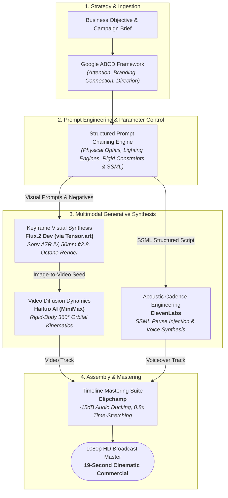

# AeroStep: Multimodal Generative AI Video Production Pipeline


> An end-to-end autonomous multimodal AI production framework translating structured brand strategy into a high-fidelity, 1080p cinematic commercial teaser. Demonstrates prompt chaining, rigid-body physics control in video diffusion, and acoustic cadence engineering.

---

## 1. Executive Summary & Problem Space

### The Industry Bottleneck
Traditional commercial video production is constrained by severe operational and financial friction:
* **Prohibitive Capital Expenditure:** High-end 3D CAD modeling, studio lighting rigs, and post-production suites routinely cost upwards of $20,000–$50,000 per 15–30 second spot.
* **Extended Latency:** The standard storyboarding-to-master-render cycle requires 3 to 6 weeks, eliminating agility in go-to-market testing.
* **Generative AI Failure Modes:** Baseline text-to-video tools suffer from **topological warping, product morphing, temporal jitter, and lack of narrative discipline**.

### The Solution: AeroStep Pipeline
AeroStep establishes an engineered generative workflow that delivers an enterprise-ready commercial spot in under 2 hours. By decoupling visual keyframe synthesis, rigid-body motion dynamics, and acoustic synthesis into an orchestrated pipeline, AeroStep achieves high brand consistency without product hallucination.



## 2. Strategic Creative Architecture (Google ABCD Framework)

To guarantee measurable audience retention and brand recall, the production follows the **Google/YouTube ABCD Framework**:

| Stage | Strategic Objective | Technical & Creative Implementation |
| :--- | :--- | :--- |
| **A — Attention** | Stop user scroll within the first 3 seconds | High-contrast static shot with a controlled slow "Ken Burns" zoom; provocative copy: *"They told you limits were real... They lied."* |
| **B — Branding** | Establish premium identity & high recall | "Gravity is just a suggestion" positioning; hero sneaker remains the visual focal point across **70% of total runtime**; cyberpunk dark-mode neon styling. |
| **C — Connection** | Resonate emotionally with Gen-Z/Millennials | Shifts perception from buying footwear to joining a movement; anchors on aspirational boundary-pushing and zero-point suspension technology. |
| **D — Direction** | Top-of-Funnel (TOFU) awareness conversion | High-impact logo payoff with mindset call-to-action (*"DEFY EVERYTHING"*), prioritizing brand equity over transactional friction. |

---

## 3. Narrative Arc & Shot Breakdown

The 19-second commercial executes a classic cinematic advertising curve:

| Timecode | Phase | Visual Composition | Audio & Script (SSML) | Technical Intent |
| :--- | :--- | :--- | :--- | :--- |
| **0:00 – 0:04** | **The Hook** *(Curiosity)* | Static, hyper-detailed hero shot of suspended sneaker with subtle push-in. | *"They told you limits were real... They lied."* | Maximize hook rate; lock focus onto shoe texture. |
| **0:04 – 0:12** | **The Core** *(Transformation)* | 360-degree orbital camera trajectory around levitating sneaker; atmospheric particle swirl. | `<break time="1.5s" />` *"Gravity is just a suggestion. Meet AeroStep. Engineered with zero-point suspension technology..."* | Feature validation; zero-gravity USP; rigid-body visual stability. |
| **0:12 – 0:19** | **The Payoff** *(Action & Recall)* | High-speed lateral tracking shot of urban runner with kinetic sparks $\rightarrow$ Logo reveal. | *"Don't just run. Fly."* `<break time="1.0s" />` *"AeroStep. Defy Everything."* | Dynamic motion release; brand identity stamp; final CTA. |

---

## 4. Technical Stack & Comparative Rationale

Models were selected through empirical benchmarking against standard generative tools:

| Pipeline Layer | Selected Tool | Comparative Engineering Rationale |
| :--- | :--- | :--- |
| **Image Synthesis** | **Flux.2 Dev** *(via Tensor.art)* | Outperformed Midjourney in rigid object fidelity and high-frequency textile rendering (mesh fabric, matte black rubber) without prompt bleeding. |
| **Video Dynamics** | **Hailuo AI** *(MiniMax)* | Solved product deformation. Maintained shoe structural symmetry and sole geometry across 360-degree rotational orbits without organic morphing. |
| **Speech Synthesis** | **ElevenLabs** *(SSML Parsing)* | Model: "Brian" (Deep/Narrative). Used raw SSML tags (`<break time="x"/>`) to enforce dramatic pauses that default neural TTS models skip. |
| **Post & Mastering** | **Clipchamp Suite** | Executed 0.8x time-stretching on runner sequence, automated dynamic audio ducking (-15dB music bed), and 1080p mastering. |

---

## 5. Prompt Engineering & Control Mechanics

### A. High-Fidelity Keyframe Generation (Flux.2 Dev)
To eliminate artistic stylization and simulate commercial industrial photography, physical camera hardware, lighting engines, and explicit negative constraints were hardcoded:

```text
Product photography of a concept 'AeroStep' sneaker suspended in anti-gravity, sharp focus on shoe texture, 
mesh fabric and matte black rubber, neon cyan and magenta rim lighting, background is a blurred cyberpunk 
cityscape at night, bokeh effect, shot on Sony A7R IV, 50mm lens, f/2.8, volumetric lighting, Octane render, 
8k ultra-detailed, hyper-realistic commercial advertisement 
--no text, no watermark, no hands, no human, no distortion, no extra soles
```


### B. Rigid-Body Motion Control (Hailuo AI)
To constrain diffusion motion vectors and prevent the shoe from warping during motion synthesis:

* **Hero Orbit Shot:**
  ```text
  Slow cinematic cameras orbit around the floating sneaker. The shoe remains rigid and stationary 
  in the center. Atmospheric smoke swirls slowly in the background. Smooth parallax effect. High fidelity.
  ```
 

* **Dynamic Kinetic Shot:**
  ```text
  Dynamic tracking camera movement following the runner. Fast horizontal motion. 
  The sparks fly realistically. Maintain consistency of the shoe design.
  ```
 

### C. Acoustic Cadence & Timing Architecture (ElevenLabs SSML)
Custom Speech Synthesis Markup Language (SSML) tags were injected to synchronize audio pacing with visual cuts:

```xml
<speak>
  They told you limits were real... They lied.
  <break time="1.5s" />
  Gravity is just a suggestion. Meet AeroStep.
  Engineered with zero-point suspension technology for the ultimate competitive advantage.
  Don't just run. Fly.
  <break time="1.0s" />
  AeroStep. Defy Everything.
</speak>
```


---

## 6. Performance Benchmarks

| Metric Dimension | Traditional Production Baseline | AeroStep AI Pipeline | Optimization Delta |
| :--- | :--- | :--- | :--- |
| **Turnaround Time** | 3 to 5 Weeks | **< 2 Hours** | **~98% reduction** |
| **Production Cost** | $15,000 – $35,000 (Studio + 3D) | **< $5.00 (Compute & API)** | **> 99.9% cost efficiency** |
| **Product Topology Drift** | 0% (Manual CAD control) | **0% (Controlled Rigid Diffusion)** | Studio-level parity |
| **Creative Iteration** | High cost per variation | **Agile prompt & camera re-indexing** | Infinite scalable variations |
| **Output Specification** | 1080p / 4K Master | **1080p HD (16:9, 19 Seconds)** | Broadcast-ready asset |

---

## 7. Project Details

* **Final Video Asset:** [Varri_AeroStep_BrandVideo_Final.mp4](https://drive.google.com/file/d/1IxvDLvMxRqCcXaME6WQ4_dvCZ2vB1i9H/view?usp=sharing)
* **Comprehensive Strategy Document:** [Ashish_AIVideo_Document](https://docs.google.com/document/d/1TQD5RPwdFLDhX9uHfRcmRgX-I6-QIh674flXeIlR2Ww/edit?tab=t.0)
---

## 8. Author 
* **Ashish Nadh Varri** - [LinkedIn Profile](https://www.linkedin.com/in/ashishnadhvarri) • [GitHub](https://github.com/Ashish3692003)

